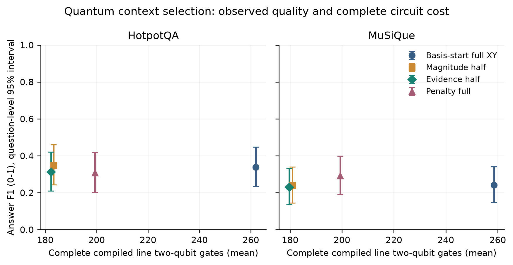

# Quantum RAG research progress and mathematical formulation

**Version 1.0 working edition | Updated November 10 2026**

The research implementation now includes token-safe retrieval, persistent caches/indexes, classical constrained selection, entity-link features, sparsification, actual QAOA simulation, downstream answer evaluation, bounded corpus experiments and a separate local demonstration service. The definitive evaluation and all declared controls are complete, and their 53,230 records pass the final artifact audit. The manuscript and release package report unfavorable findings as well as measured resource changes.

The study distinguishes three effects: the scoring formulation, the solver's ability to optimize that formulation, and the generator's ability to answer from the resulting passages. It does not assume that lower energy means better evidence or better answers. All quantum execution is simulated on the laptop; no practical quantum advantage or physical-device result is claimed.

The historical three-question baseline is retained below, followed by phase-by-phase methods, mathematics, development measurements and decisions. It is an execution check, not the final scientific result. The [technical foundations](TECHNICAL_FOUNDATIONS.md) provide longer derivations and worked examples; this report connects the implemented methods to measured outcomes and limitations.

## Research objective

The proposed study asks whether question-specific evidence relationships can guide sparsification of the context-selection objective while preserving multi-hop answer quality and reducing compiled QAOA resource costs.

A passage can be topically relevant without supplying a needed fact. Complementary passages may jointly answer a question. The implemented graph feature is a transparent entity-link proxy for such relationships, not verified semantic evidence or a guarantee of factual reasoning.

The contribution remains conditional on the literature review and experiments. Prior work covers QUBO evidence selection, passage set selection, graph retrieval and QAOA sparsification [1–4]. Combining those ideas alone does not establish novelty.

## Implementation status

The implemented flow is supplied or commonly retrieved candidates → token-safe MiniLM features → entity-link coefficients → count/token-constrained selection → consistently ordered context → fixed Qwen generation → evaluation and artifacts. Reference annotations enter only the evaluator. Quantum conditions use count constraints; token-budget quantum encoding is not claimed.

| Phase | Current status | Implemented scope and remaining work |
| --- | --- | --- |
| A reproducibility and protocol | Implemented | Measured CUDA environment, pinned model revisions, laptop package snapshot, protocol, 19-source comparison and remote CI |
| B data and answer evaluation | Implemented | Two frozen dataset splits, source mappings, aliases, official-score agreement and real diagnostics |
| C retrieval and caching | Implemented | Token-safe chunks, content-addressed embeddings, FAISS/SQLite persistence, lexical/hybrid/reranking baselines |
| D optimization and evidence modeling | Implemented with scope limits | Signed MILP, token/count budgets, heuristics, entity-link features and provenance; independent semantic graph annotation remains external |
| E QAOA and resources | Implemented | Ising/spectrum checks, penalty/XY circuits, exact/shot/noisy simulations and complete compilation |
| F sparsification method | Implemented | Four rules, hard edge budgets, development calibration and negative-result research decision |
| G frozen evaluation | Complete | 18 primary conditions and six separately scoped control runs; 53,230 records audited and public statistics reconstructed |
| H manuscript and demonstration | Complete within local scope | Numerical manuscript, 13-page visually checked PDF, real-model API/container checks, persistence and batch profiling; browser review remains unavailable |
| I submission package | In progress | Restoration/audit/export tooling prepared; final reproducible release and external authorship/submission decisions remain |

Implementation status does not establish scientific superiority or publication acceptance. Earlier exploratory document-recall comparisons used classical optimization and unequal selection sizes; their figures are not directly comparable to the controlled answer evaluation. The following initial derivation and three-question result are historical; later phase sections describe their extensions.

## Historical baseline formulation and its reusable foundations

For normalized question and passage embeddings u and vᵢ, define relevance and nonnegative redundancy:

$$
r_i=u^\top v_i,\qquad S_{ij}=\max(v_i^\top v_j,0).
$$

The first count-constrained selection model minimized:

$$
E(x)=-\alpha\sum_i r_i x_i+\beta\sum_{i<j}S_{ij}x_ix_j,
\qquad \sum_i x_i=k,\quad x_i\in\{0,1\}.
$$

Each passage pair is counted once. The negative term rewards relevance; the positive term penalizes similar selected passages. These scores are proxies for useful evidence, not answer probabilities.

MILP replaces each product by a continuous auxiliary variable and imposes:

$$
0\le y_{ij}\le1,\quad y_{ij}\le x_i,\quad y_{ij}\le x_j,\quad
y_{ij}\ge x_i+x_j-1.
$$

With binary x, these inequalities enforce yᵢⱼ = xᵢxⱼ exactly. SciPy/HiGHS solves the resulting linear formulation with the native count constraint [5]. Status, bounds and feasibility distinguish certified optima from limited executions.

Ranking maximizes individual relevance under the same count budget; its selection is additionally scored under the full energy. It is a policy baseline. The later MILP–QAOA comparisons keep the objective and feasible set fixed within each condition.

The later graph extension adds a complementarity reward. Token-budget constraints and quantum encodings were absent from this historical six-record run; their actual implementations and measured diagnostics are described in Phases D–F below.

## Evaluation and experimental controls

Answer exact match compares normalized strings. Token F1 uses multiset overlap with HotpotQA's normalization and special-answer rules [7]. Document recall measures the fraction of annotated supporting titles selected; complete support records whether all such titles are present. These document metrics are not sentence-level supporting-fact F1.

The common model revisions, candidate pools, ordering and prompt policy control several variables. Exactly five selected passages controls count, but not token length. Failed executions remain in answer denominators; evidence and token summaries are successful-only and labeled accordingly.

## Verified development experiment

The experiment ran on November 4. Its saved predictions, coefficients, references and hashes were audited on November 9. No new model inference was performed during documentation updates.

<!-- BEGIN VERIFIED BASELINE RESULTS -->

Run identifier: baseline_dev_001. The input is the first three already inspected questions in the processed development set, drawn from HotpotQA's training partition. The same candidates, normalized embeddings, ordering policy and generator settings were used for both methods. These examples are not an untouched evaluation set.

| Setting | Recorded value |
| --- | --- |
| Embedding model | sentence-transformers/all-MiniLM-L6-v2 |
| Generator | Qwen/Qwen2.5-1.5B-Instruct |
| Selection budget | Exactly five passages per method on each example |
| Weights and seed | α = 1.0, β = 0.2, seed = 42 |
| Execution | CPU float32, four PyTorch threads |
| Generation | Deterministic decoding, at most 32 new tokens |
| Input policy | 4,096-token total limit with output space reserved |
| MILP limit | 10 seconds per selection, zero requested relative gap |
| Model preparation | 4.72 seconds |
| Recorded invocation wall time | 61.32 seconds |

The model revisions and runtime versions are preserved in the evidence snapshot. Models loaded from local snapshots; document embeddings were recomputed once per question and shared between selectors. A persistent embedding cache is not implemented.

| Measurement over three questions | Relevance top k | MILP |
| --- | ---: | ---: |
| Successful executions | 3 of 3 | 3 of 3 |
| Mean passages selected | 5.00 | 5.00 |
| Answer exact match | 0.3333 | 0.3333 |
| Answer token F1 | 0.3333 | 0.3333 |
| Supporting-document recall | 0.6667 | 0.8333 |
| Complete supporting-document coverage | 0.3333 | 0.6667 |
| Mean context tokens | 615.33 | 710.00 |
| Mean generation time in seconds | 8.54 | 9.15 |

No embedding truncation or generated-output-limit hit occurred. All three MILP selections reported optimal status for the specified count-constrained objective.

| Example | Ranking energy | MILP energy |
| --- | ---: | ---: |
| Q1 body double | −1.317200 | −1.842702 |
| Q2 literary movement | −1.657102 | −1.749583 |
| Q3 film | −1.663005 | −1.727368 |

All energies use the same full objective for each question. Lower values are better under that objective. They are not answer probabilities or evidence of a quantum improvement.

| Example | Reference | Ranking answer | MILP answer | Token F1 for both |
| --- | --- | --- | --- | ---: |
| Q1 body double | Rosie Mac | Rosie Mac | Rosie Mac | 1.0 |
| Q2 literary movement | Romantic | Romanticism | Modernismo | 0.0 |
| Q3 film | Richard E. Grant | Jack and Sarah | Jack and Sarah | 0.0 |

Q1 corresponds to 5abed9f45542994516f4545a, Q2 to 5ab1dd6c5542993be8fa9860 and Q3 to 5adfa059554299025d62a2f8.

<!-- END VERIFIED BASELINE RESULTS -->

## Historical baseline interpretation and limitations

MILP improved objective values and annotated document recall on this sample without improving aggregate answer EM/F1. Its contexts were longer in tokens despite identical passage counts. A token-budget comparison is needed to isolate that difference.

Q2 illustrates metric sensitivity: Romanticism and Romantic have no exact normalized token overlap. MILP's Modernismo prediction is a separate error requiring evidence inspection. Q3 asks for a film but has a person as its reference; the November 4 investigation found the same inconsistency in the cached upstream record. The original primary reference is retained.

Three inspected development questions, one seed and one generator cannot establish significance or general superiority. No corpus-scale benefit, novel graph result or quantum advantage has been demonstrated.

## Historical baseline correctness and reproducibility

Seventeen offline test methods passed again on November 9, covering label isolation, metric edge cases, signed-pair optimization, count boundaries, MILP/exhaustive agreement, solver limits, configuration and resume/failure behavior. The CI workflow exists; a completed remote CI run is not claimed.

The manifest records model revisions, configuration, question IDs, runtime/device and source/data hashes. Question-level records retain prompts, predictions, selections, coefficients, metrics and status. Saved energies and metrics were independently recomputed, aggregates checked and recorded source/data hashes verified.

Full local artifacts are in results/baseline_dev_001. A [compact evidence snapshot](research_report/evidence/baseline_dev_001.json) preserves configuration, artifact hashes and six outcomes. Hashes identify an execution state but do not archive the source, dataset or complete software environment.

## Backlog recorded after the first baseline

Immediate work includes the structured prior-work comparison, data provenance and frozen splits, token-aware chunking, persistent embeddings and token-budget selection. Further classical baselines will precede graph-feature and QAOA comparisons.

The quantum study will account for mapping, constraints, state preparation, mixers, compilation and noise. Cardinality penalties can introduce all-pairs couplings, so a sparse semantic graph alone cannot establish circuit savings. Full and sparse objective values will be reported separately.

The final evaluation targets an additional multi-hop dataset and generator, fresh examples, multiple seeds, ablations, corpus retrieval and paired uncertainty estimates. An API and evidence-inspection demonstration will reuse the research library.

Detailed derivations and worked examples are in [Technical foundations and implementation notes](TECHNICAL_FOUNDATIONS.md). The [development sequence](DEVELOPMENT_SEQUENCE.md) records component dependencies, decisions and phase status.

## References and implementation pointers

1. Singh and Vadlamani. [QUBO Optimized Evidence Selection for Retrieval Augmented Question Answering with Unconventional Solvers](https://arxiv.org/abs/2607.12334). 2026 preprint; a direct formulation-overlap lead for the literature review.
2. Lee and colleagues. [Shifting from Ranking to Set Selection for Retrieval Augmented Generation](https://aclanthology.org/2025.acl-long.861/). ACL 2025.
3. Melo and colleagues. [Do Not Forget the Base Retriever](https://aclanthology.org/2025.emnlp-industry.174/). EMNLP Industry 2025.
4. Moondra and colleagues. [Promise of Graph Sparsification and Decomposition for Noise Reduction in QAOA](https://arxiv.org/abs/2406.14330). Relevant sparsification research; not evidence for the proposed RAG method.
5. SciPy. [MILP interface and solver status documentation](https://docs.scipy.org/doc/scipy/reference/generated/scipy.optimize.milp.html).
6. IBM Quantum. [Quantum approximate optimization algorithm](https://quantum.cloud.ibm.com/docs/en/tutorials/quantum-approximate-optimization-algorithm).
7. HotpotQA. [Official answer and supporting-fact evaluator](https://github.com/hotpotqa/hotpot/blob/master/hotpot_evaluate_v1.py).

Current implementation pointers: [data boundaries](../src/qrag/data.py), [objective and MILP](../src/qrag/optimization.py), [model adapters](../src/qrag/models.py), [metrics](../src/qrag/metrics.py), [runner](../src/qrag/experiments/run.py), [artifacts](../src/qrag/experiments/artifacts.py), [configuration](../configs/dev_baselines.toml), [tests](../tests/test_baselines.py) and [legacy QAOA wrapper](../src/optimization/qaoa_solver.py).

## Phase A — measured environment and research protocol (November 10, 2026)

The execution environment now exposes CUDA. The measured RTX 5060 has approximately 7.53 GiB of PyTorch-visible device memory; the host provides 16 logical CPUs. The earlier CPU-only experiment remains unchanged. GPU tensor multiplication, a two-qubit Bell-state simulation and a HiGHS binary optimization were executed, rather than inferring compatibility from installed versions. The baseline's 17 offline tests pass and pip reports no broken requirements.

The [environment evidence](research_report/evidence/environment_20261110.json), [host-specific dependency snapshot](../requirements-laptop.lock), [research protocol](EXPERIMENT_PROTOCOL.md) and [19-source literature matrix](LITERATURE_REVIEW.md) establish the execution foundation. The lock records installed transitive dependencies for this Linux/Python/CUDA host; it is not a universal GPU installation recipe.

The contribution shortlist is evidence-guided interaction removal and its dependence on constraint encoding. Prior work already covers QUBO evidence selection and QAOA sparsification. An exact reproduction of the closest paper has not been achieved: its requirement estimators and original model configuration are different. A transparently labeled local adaptation is planned. No new answer-quality improvement or quantum advantage is claimed in this phase.

Historical schedules are superseded by a quality-first execution order. The study will use laptop compute, frozen held-out IDs, paired comparisons and explicit simulation labels. Full literature novelty certification, external review and publication acceptance are not software acceptance criteria.

## Phase B — data boundaries, frozen splits and scorer verification

The new adapters preserve original HotpotQA sentences and supporting sentence indices. MuSiQue keeps paragraph identities separately from titles, because distinct paragraphs can share a title. Answer aliases and supporting annotations remain in evaluation-only objects. Invalid mappings fail validation.

The [split manifest](../configs/splits/research_v1.json) freezes 100 development and 500 held-out questions per dataset, before model evaluation on the held-out data. Earlier local HotpotQA IDs and normalized questions were excluded. The new held-out material comes from official validation/dev partitions, not a hidden test set. Normalized exact matching and token-trigram Jaccard at 0.8 found no near matches between the selected new development questions and the evaluation candidate samples. This limited audit cannot rule out paraphrases, shared facts or model pretraining contamination. No structural rejection was needed in the sampled preparation pass.

HotpotQA retains 228 supporting sentence annotations across the development sample and 1,223 across evaluation. MuSiQue has paragraph support, not sentence support; its 100 development questions include 44 answer aliases and its 500 evaluation questions include 199. Raw data remain outside Git. Sources, licenses, immutable HotpotQA revision, official MuSiQue archive hash, IDs and file hashes are recorded in the manifest.

The [metric audit](research_report/evidence/metric_verification.json) compares 1,004 deterministic answer pairs per dataset against inspected official evaluator functions: every EM and F1 agrees. The offline suite now has 21 passing tests. A six-generation GPU diagnostic uses three development questions with empty or gold-evidence context; its [records](research_report/evidence/phase_b_diagnostics.json) preserve answers, token counts and metrics. These diagnostic contexts have different sizes and are not a fair selector comparison. Neither the diagnostic nor metric verification establishes a method improvement.

Generation now records input token IDs and explicitly records its numeric precision. The new float16 GPU execution is a separate condition from the original float32 CPU experiment. No weights are trained or changed.

## Phase C — token-safe retrieval, cache and persistent index

Implemented sentence-aware chunks with original character ranges and sentence IDs. Long sentences are split into overlapping token windows; ordinary sentence boundaries are preserved. Embedding input includes a bounded title prefix and is checked against the model limit. All chunks contribute to a document representation through mean pooling followed by unit normalization. This explicitly changes the earlier truncated-passage representation; its benchmark outcomes must not be merged with the historical baseline.

Added a SQLite content-addressed embedding cache, separate query/document namespaces, checksums, model/policy identity, an exact FAISS inner-product index with SQLite metadata, BM25, reciprocal-rank fusion and a revision-pinned cross-encoder with maximum-over-chunks aggregation. Index loading verifies both vector and metadata checksums. These are reusable library components; installing them alone is not an end-to-end corpus benchmark.

In a [50-question development profile](research_report/evidence/retrieval_profile.json), the first encoding pass had 584 misses and no hits and took 1.587 seconds with the model already loaded. The repeated pass had 584 hits, no misses and took 0.296 seconds. These are feature-stage measurements, not end-to-end RAG latency. The 534-chunk index returned identical results after restoration. All 25 offline tests pass, including long-sentence text coverage, changed cache identity, corrupt cache entries and index corruption.

Fixed-count and generator-token-budget selection will be integrated with the native solver constraints in Phase D. A restored index and a cache speedup do not establish answer-quality improvement. The cross-encoder is downloaded and implemented; its real comparative results are deferred to controlled evaluation.

## Phase D — constrained selectors and transparent evidence features

Implemented native token-budget constraints alongside exact-count constraints. MILP uses the same signed pair objective and continuous product variables in both modes. Added MMR, greedy energy descent, greedy lexical coverage, and seeded simulated annealing with feasible swaps/additions/deletions. BM25, hybrid and cross-encoder rankings select through the same budget validator. All methods receive the same candidate text and generator settings.

The evidence representation is explicitly an entity-link graph, not a verified factual knowledge graph. Candidate-title mentions and capitalized spans retain exact source offsets. A question-term anchor score and positive dense relevance weight linked passage pairs. Shared names are weak indicators of possible bridges, not proof of complementary facts. Extraction artifacts are cached by inference content and extractor revision, with payload checksums. Typed relation extraction is not justified by the current negative pilot and remains a conditional extension.

The [50-question fixed-count pilot](research_report/evidence/phase_d_development.json) contains 500 successful method/question records. Mean answer F1: top-k 0.6123; BM25 0.6370; hybrid 0.5897; reranker 0.5780; MMR 0.5631; greedy coverage 0.6409; base MILP and annealing 0.5818; graph MILP with gamma=0.8 0.5455. Every method selects five passages, but token lengths differ. These development estimates do not establish a statistically supported ranking. The negative graph result is retained and motivates checking feature alignment rather than claiming improvement.

The separate [900-token development pilot](research_report/evidence/phase_d_tokens.json) contains 100 successful records on 10 questions. Every actual assembled context is within the cap. Base MILP mean F1 is 0.475 and top-k is 0.675; coverage is 0.755. Mean selected counts differ because this is a token-budget experiment. It must not be pooled with the fixed-count pilot.

Twenty-nine offline tests pass. MILP matches exhaustive optima on signed-pair token-budget cases; infeasible minimum-count cases return no solution. The study runner preserves exact source snapshots, coefficients, graph provenance, prompts, token IDs and per-method failures. Identical selections reuse deterministic generation within a question, with explicit reuse and actual-execution timing fields. The exported compact evidence preserves outcomes without redistributing full passage prompts.

An independent annotated entity-resolution audit and exact original-model prior-work reproduction are not completed. Neither graph labels nor gold reference fields enter the normal graph/solver/generator path.

## Phase E — actual QAOA, feasibility and circuit resources

Implemented and executed Qiskit QAOA using the same fixed-count selection instances as MILP. Exact statevector expectation optimization is distinguished from final finite-shot measurements. A separate method uses 256 training shots per objective evaluation. No quantum hardware, hardware speedup or noisy parameter optimization is claimed.

The implementation verifies the QUBO/Ising spectrum and little-endian bit mapping, uses a sufficient cardinality-penalty strength or a count-preserving XY mixer, records every optimizer evaluation, and selects the lowest surrogate-energy feasible measured sample without repair. It compiles the complete circuit, including initialization and mixer, to rz/sx/x/cx on explicitly synthetic all-to-all and line targets. The line is not a calibrated device.

The [10-question development experiment](research_report/evidence/phase_e_qaoa.json) contains 140 successful records: MILP, both mixers at depths 1 and 2 and three seeds, plus finite-shot training. Mean answer F1 across the balanced three-seed groups: XY p=1 0.4167; XY p=2 0.4617; penalty p=1 0.4417; penalty p=2 0.4750. MILP is 0.4750. These small development figures support execution and diagnostics, not superiority claims.

Ideal XY final shots are all feasible. Mean penalty feasible fractions are 0.3622 at p=1 and 0.5270 at p=2. Mean compiled line two-qubit gates are 261.03/546.07 for XY at depths 1/2 respectively, and 199.33/396.67 for penalty at those depths. Thus preserving count did not make this dense circuit cheaper. Resource distributions and paired uncertainty belong to final evaluation.

A separate [three-question, eight-candidate diagnostic](research_report/evidence/phase_e_noise.json) applies synthetic depolarizing noise only during final sampling. Ideal XY feasibility is 1; noisy feasible fractions are 0.6494, 0.6641 and 0.6270. Angles are still trained ideally. These are simulation results with an artificial noise model, not physical-device estimates. Quantum token-budget encoding remains conditional and is not implemented; token-budget comparisons currently use classical selectors.

The offline suite now has 32 passing tests. The laptop statevector study is explicitly capped at 16 candidates, avoiding any suggestion that these simulations establish large-scale quantum performance.

## Phase F — calibrated weights, sparsification and research decision

A development-only sweep used 100 questions per dataset and gamma in {0,0.1,0.2,0.4,0.8}. Gamma=0.2 maximized the unweighted mean answer F1 across the two development datasets; the decision and all scores are [recorded](../configs/development_decision.json). HotpotQA base/selected-weight F1 is 0.6358/0.6533; MuSiQue is 0.1868/0.2205. These are tuned development results, not held-out gains. Greedy lexical coverage remains a strong comparator. The earlier gamma=0.8 negative result is not removed.

Implemented exact unordered-edge budgets for absolute magnitude, seeded random, endpoint-degree ranking and evidence-guided protection. Evidence guidance reserves up to half the hard edge budget, rounded upward, for high-priority possible bridges and fills the rest by coefficient magnitude. It never silently exceeds the total budget, even if more links are candidates for protection. Retained coefficients keep their signs. Every solution is scored under both its sparse surrogate and the original full objective.

The [30-question development ablation](research_report/evidence/phase_f_sparsification.json) contains 900 successful records. Full graph MILP mean F1 is 0.6203; full XY-QAOA is 0.5634; uniform best-of-1,024 feasible samples is 0.6203. At half edges, QAOA absolute and evidence-guided selection both score 0.4834; the corresponding sparse MILPs score 0.4491 and 0.4891. Small-sample/tuning limitations prevent a general ranking claim.

Mean line two-qubit gates fall from 263.87 for full XY-QAOA to 176.43 for absolute and 176.63 for evidence-guided half-edge variants. The half-edge penalty variants both have 45 encoded pairs and 199 mean line gates. Thus edge removal does reduce complete compiled cost in one encoding while the penalty can erase structural savings. It does not establish preserved answer quality.

Research decision: continue as an encoding-aware comparative study rather than promise a positive evidence-preservation result. The [analysis](research_report/evidence/phase_f_analysis.json) retains paired uncertainty. Add uniform feasible sampling to final comparisons because best-of-many measurements can cover much of a small feasible space. No quantum advantage is inferred from finding a good subset after many classical energy evaluations.

The study runner now uses an append/fsync journal with explicit error retries and torn-tail recovery. Successful records cannot be overwritten; a changed resume identity fails before file mutation. Report generation groups repeated solver seeds within question before resampling. Thirty-eight offline tests pass. A reconstruction check rebuilt all four frozen dataset files in a separate directory and matched their exact hashes.

## Phase G preparation — frozen evaluation matrix

Before new held-out execution, froze [18 configurations](../configs/final_matrix.json) specifying 50,290 method/question evaluations. The main classical comparison uses 500 questions per dataset with Qwen 1.5B and Qwen 3B. Token studies use the first 100 frozen IDs per dataset/generator. The principal quantum comparison uses 50 frozen IDs per dataset, a common label-independent top-10 pool, and three solver seeds. Larger MuSiQue quantum sensitivities use five questions at 12/16 real candidates. Bounded corpus studies use 25/50/100 candidates with separately stated sample sizes and one-second MILP limits.

The bounded corpora contain 5,941 HotpotQA documents/6,270 chunks and 8,582 MuSiQue documents/8,972 chunks, deduplicated by title plus text from permitted benchmark input passages. They are not full Wikipedia. Candidate retrieval uses only the question and corpus; supporting labels are mapped afterward for evaluation, including retrieval misses.

Qwen 3B completed a development generation using approximately 6.49 billion peak allocated GPU bytes. One 16-candidate development QAOA profile took 1.05 seconds. These are smoke/profile checks, not general resource or accuracy conclusions. Thirty-nine offline tests and the configured lint checks pass. The evaluation results are not yet complete at this preparation checkpoint.

## Phase G implementation erratum before the definitive run

The first execution cycle exposed a provenance assertion bug on “İstanbul High School”: Unicode-aware case-insensitive regex matching does not imply equality of the two case-folded strings. One HotpotQA question failed in the first count run for all 19 methods. The matrix was stopped, all started run artifacts were retained under a separate archive, and the source-span check was repaired to store the actual surface text separately from the canonical entity name. A Unicode regression test now verifies exact source offsets. The graph-cache revision was incremented.

All 18 conditions will be restarted under the repaired code. Models, IDs, budgets, gamma, selectors, sparsifiers and analysis decisions are unchanged. This is an implementation repair, not a new development search using held-out answer scores. The [erratum evidence](research_report/evidence/evaluation_cycle1_erratum.json) identifies the superseded runs; those outcomes are excluded from definitive comparisons. SQLite connections are also now explicitly closed after graph/index transactions, without changing their numerical definitions. Forty-five offline tests pass.

## Phase H preparation — service and manuscript source

A separate service package now calls the common frozen research library. It provides strict input schemas, a one-worker bounded inference queue, SQLite job persistence, readiness/health endpoints, explicit quantum-to-classical fallback, persistent corpus ingestion/query endpoints and structured stage traces. A dashboard exposes source selection, generated answers, token use and simulation costs. It does not treat supplied sources as verified citations or claim that prompt wording prevents injection.

The full CPU container builds successfully from a pinned Python image and resolves both immutable local model snapshots through a read-only model-cache mount. HTTP checks verify the dashboard, health and truthful cold readiness responses. Forty-five local tests pass, including validation, queue-full behavior, failure recording, restart handling and explicit fallback. Real-model HTTP benchmarking is scheduled after the research jobs to avoid competing for model memory. No enabled browser is available for visual dashboard review.

An editable manuscript source and a ReportLab PDF renderer are prepared. Final results and conclusions remain unfilled until the definitive matrix and separately declared controls complete. The secondary controls add a common complete-compiled-gate cap and base-versus-graph QAOA comparison without changing the 18 primary configurations.

## Phase G numerical diagnostic — sampling and preparation

A separate development-only mechanism study completed 480 circuit solves: 20 genuine MuSiQue coefficient instances, four nested candidate counts (8/10/12/16), two encodings and three seeds. It uses exact feasible energies and trained ideal statevector probabilities; it does not generate or evaluate additional answers. [Numerical evidence](research_report/evidence/sampling_coverage.json), [derived table](../paper/results/sampling_coverage.md) and [driver](../scripts/sampling_coverage_study.py) retain the settings and outputs.

If a single draw hits any optimum with probability u, S independent draws hit one with probability 1-(1-u)^S. Uniform feasible draws with n=10,k=5 have 252 possible subsets and approximately 0.9829 optimum coverage after 1,024 draws when the optimum is unique. At n=16,k=5, there are 4,368 subsets and coverage is approximately 0.2090. This is a strong classical control at the small sizes used here, even before comparing solver training cost.

The study exposed a structural limitation in the original circuit. For a computational basis state |x0>, the diagonal cost layer gives exp(-i gamma E(x0))|x0>, which is only a global phase. Later mixing does not make that common factor observable. The original p=1 XY probabilities therefore do not depend on the first cost angle. Optimizing its mixer angle can still depend on the energy coefficients; this is not equivalent to saying its entire output ignores the objective. At p=2, the later cost layer can create relative phases.

This limitation is now explicitly documented and regression-tested. The original primary matrix is retained unchanged. An exploratory [preparation control](../configs/preparation_control.json) adds a fixed pi/4 XY ring sweep before cost evolution, creating a generally nonuniform feasible superposition. Its entire preparation circuit is included in compilation. It uses the same first 50 frozen quantum questions per dataset and fixed existing weights; it does not tune preparation against held-out answers. The extension's source bytes and composite identity are saved independently of the frozen core.

Generic compilation counts are measurements under a stated compiler policy, not minimum required circuit costs. A compiler aware of the original known basis state could remove first-layer diagonal work. The final interpretation must include this limitation and distinguish the prepared control from the predeclared comparison.

## Phase H packaging and review preparation checkpoint

The CPU container's observed model-runtime and service dependencies are now pinned separately from the CUDA host. The locked image rebuild succeeds, pip reports no incompatible requirements, and a new nonroot instance returns health 200, truthful cold readiness 503 and dashboard 200. This establishes packaging and HTTP startup; actual model-job measurements remain scheduled after the research runs.

All 46 local correctness tests pass. The expanded GitHub research workflow passes, including real Qiskit tests, targeted type checks, lint, wheel and container checks. A lighter workflow initially failed because the new quantum regression assumed an optional package was installed; it now skips that integration explicitly when Qiskit is absent, while the full workflow still executes it. This change does not alter scientific execution.

An unjudged [source-grounded graph worksheet](research_report/annotation_sample.json) records 40 edges from the first ten development questions per dataset, including exact mention surfaces and excerpts. It has no completed human judgments and is not reported as semantic extraction accuracy. New [reproduction](REPRODUCIBILITY.md), [service](SERVICE_GUIDE.md), [publication](PUBLICATION_GUIDE.md) and [attribution](RIGHTS_AND_ATTRIBUTION.md) guides document the practical artifact boundaries and remaining external decisions.

<!-- BEGIN DEFINITIVE_RESULTS -->
## Phase G — definitive evaluation and independent audit

The 18-condition definitive primary matrix is complete: **50,290 method/question evaluations over 1,000 distinct held-out questions**. Separate controls add 800 formulation, 140 gate-cap and 2,000 prepared-circuit records, giving **53,230 records across 24 completed runs**. All 24 grids were audited. The primary and formulation runs share the same frozen core source fingerprint; the preparation control adds an explicitly hashed extension. Documentation and service commits changed during execution, so a common scientific source hash is more precise than claiming one repository commit for every run.

The audit recomputed dataset-specific scores, checked IDs/counts/token budgets, summed full and sparse energies independently, verified source/config/data identities and retokenized saved prompts. It independently counted feasible shots from measured bit strings, including failed circuits. The gate diagnostic's retained masks and final complete line circuits were reconstructed and recompiled. Its successful circuits satisfy the 180-gate cap. [Audit evidence](research_report/evidence/final_audit.json) records every checked condition.

There is one genuine no-feasible-sample failure in the primary matrix: HotpotQA question `5add9bfa5542990dbb2f7e85`, penalty-full seed 42. It remains zero in answer averages and zero in completed-circuit feasibility. Twenty additional gate-cap control records reject the penalty encoding because no tested retention level fits the cap; they are explicit diagnostic failures rather than successful substituted executions. No service fallback enters scientific results.

### Findings and interpretation

The principal half-edge comparison does **not establish an evidence-guidance benefit** on either dataset. Both intervals include zero, so neither equality nor noninferiority follows. Lexical coverage has the highest observed F1 in all four 500-question classical count conditions. Graph-minus-base effects vary across settings and their reported exploratory intervals also include zero. These results support a bounded comparative/negative-result account, not a new state-of-the-art or quantum-advantage claim.

### Classical supplied-pool answers

| Dataset / generator | Method | N | Answer F1 | EM |
| --- | --- | ---: | ---: | ---: |
| hotpotqa / qwen15 | top_k | 500 | 0.4402 | 0.3460 |
| hotpotqa / qwen15 | bm25 | 500 | 0.4737 | 0.3680 |
| hotpotqa / qwen15 | reranker | 500 | 0.4538 | 0.3560 |
| hotpotqa / qwen15 | coverage | 500 | 0.4944 | 0.3860 |
| hotpotqa / qwen15 | milp_base | 500 | 0.4546 | 0.3520 |
| hotpotqa / qwen15 | milp_full | 500 | 0.4517 | 0.3500 |
| hotpotqa / qwen3 | top_k | 500 | 0.4200 | 0.3340 |
| hotpotqa / qwen3 | bm25 | 500 | 0.4545 | 0.3740 |
| hotpotqa / qwen3 | reranker | 500 | 0.4266 | 0.3320 |
| hotpotqa / qwen3 | coverage | 500 | 0.4801 | 0.3820 |
| hotpotqa / qwen3 | milp_base | 500 | 0.4220 | 0.3400 |
| hotpotqa / qwen3 | milp_full | 500 | 0.4357 | 0.3540 |
| musique / qwen15 | top_k | 500 | 0.2434 | 0.1660 |
| musique / qwen15 | bm25 | 500 | 0.2247 | 0.1580 |
| musique / qwen15 | reranker | 500 | 0.2378 | 0.1760 |
| musique / qwen15 | coverage | 500 | 0.2714 | 0.1920 |
| musique / qwen15 | milp_base | 500 | 0.2448 | 0.1720 |
| musique / qwen15 | milp_full | 500 | 0.2491 | 0.1740 |
| musique / qwen3 | top_k | 500 | 0.1594 | 0.1160 |
| musique / qwen3 | bm25 | 500 | 0.1418 | 0.1060 |
| musique / qwen3 | reranker | 500 | 0.1677 | 0.1220 |
| musique / qwen3 | coverage | 500 | 0.1896 | 0.1400 |
| musique / qwen3 | milp_base | 500 | 0.1652 | 0.1140 |
| musique / qwen3 | milp_full | 500 | 0.1599 | 0.1100 |

F1/EM use a 0-1 scale. Each main condition has 500 questions. The complete method tables, token lengths, failures and paired intervals are released with the artifacts; selected headline rows above do not replace them.

### Quantum quality, feasibility and complete cost

| Dataset | Method | Answer F1 | Feasible shots | Line 2Q gates |
| --- | --- | ---: | ---: | ---: |
| hotpotqa | milp_full | 0.3311 | - | - |
| hotpotqa | random_full | 0.3378 | - | - |
| hotpotqa | xy_full_p1 | 0.3379 | 1.0000 | 261.9 |
| hotpotqa | xy_full_p2 | 0.3051 | 1.0000 | 545.0 |
| hotpotqa | xy_absolute_f0.5 | 0.3490 | 1.0000 | 183.2 |
| hotpotqa | xy_evidence_f0.5 | 0.3128 | 1.0000 | 182.2 |
| hotpotqa | penalty_full | 0.3079 | 0.3574 | 199.3 |
| hotpotqa | penalty_absolute | 0.3200 | 0.3515 | 199.3 |
| hotpotqa | penalty_evidence | 0.3013 | 0.3562 | 199.3 |
| musique | milp_full | 0.3178 | - | - |
| musique | random_full | 0.3178 | - | - |
| musique | xy_full_p1 | 0.2418 | 1.0000 | 258.6 |
| musique | xy_full_p2 | 0.2436 | 1.0000 | 544.2 |
| musique | xy_absolute_f0.5 | 0.2399 | 1.0000 | 180.9 |
| musique | xy_evidence_f0.5 | 0.2304 | 1.0000 | 179.7 |
| musique | penalty_full | 0.2919 | 0.3753 | 199.3 |
| musique | penalty_absolute | 0.2667 | 0.3687 | 199.3 |
| musique | penalty_evidence | 0.2644 | 0.3617 | 199.3 |

The quantum conditions use the same 50 reduced-pool questions per dataset. Three seeds are averaged within question for F1. Feasibility and gate means include all completed circuits, including zero-feasible-sample failures. Classical rows have no quantum gate count rather than an invented zero. Gates describe a complete compiled circuit on the synthetic line.

### Principal half-edge comparison

| Dataset | Evidence minus magnitude F1 | 95% paired interval |
| --- | ---: | --- |
| hotpotqa | -0.0363 | [-0.0843, 0.0035] |
| musique | -0.0095 | [-0.0461, 0.0199] |

These intervals compare evidence guidance with magnitude retention on identical questions and budgets. An interval spanning zero does not establish equality or noninferiority.

### Secondary complete-gate-cap control

| Dataset | Rule | N | F1 | Mean line 2Q | Failed records |
| --- | --- | ---: | ---: | ---: | ---: |
| hotpotqa | gate_absolute | 10 | 0.2500 | 170.1 | 0 |
| hotpotqa | gate_evidence | 10 | 0.2500 | 170.1 | 0 |
| hotpotqa | gate_penalty_control | 10 | 0.0000 | - | 10 |
| musique | gate_absolute | 10 | 0.2033 | 171.9 | 0 |
| musique | gate_evidence | 10 | 0.2167 | 171.9 | 0 |
| musique | gate_penalty_control | 10 | 0.0000 | - | 10 |

The cap is 180 complete compiled line two-qubit gates. Retention is chosen using declared inference-only prefix trials and verified after angle optimization. Infeasible penalty encodings and final-cap violations remain failures. Actual resource consumption can differ below a shared cap.

### Additional settings and failures

The definitive primary matrix contains 50,290 method/question evaluations. Outside the deliberately restrictive gate-cap diagnostic, the grouped tables contain 1 failed method records. Token studies, bounded corpora, larger-quantum sensitivities and the base/graph QAOA control are separately tabulated in the released result directory. Their smaller samples are not pooled into the principal comparison.

All aggregate values derive from question-level artifacts. Successful-only resource summaries exclude failed executions and are labeled accordingly. Timings are descriptive laptop measurements; software packaging tasks ran concurrently with parts of evaluation, so they are not isolated production-throughput benchmarks.

### Exploratory feasible-superposition control

The frozen XY implementation starts from a basis state. Its first diagonal cost layer contributes only a global phase; at p=1 its cost angle cannot affect probabilities. We retained those results and separately added one fixed pi/4 XY ring sweep before the first cost layer. This creates a feasible, generally nonuniform superposition and makes subsequent cost phases observable after mixing. The added sweep is included in complete compilation. This control was introduced after the analytic diagnosis and is exploratory, not a replacement for the principal frozen comparison.

| Dataset | Prepared method | F1 | Mean complete line 2Q |
| --- | --- | ---: | ---: |
| hotpotqa | prepared_base_p1 | 0.3291 | 352.9 |
| hotpotqa | prepared_full_p1 | 0.2922 | 354.3 |
| hotpotqa | prepared_full_p2 | 0.3134 | 642.3 |
| hotpotqa | prepared_absolute_f0.5 | 0.2903 | 275.4 |
| hotpotqa | prepared_evidence_f0.5 | 0.3055 | 273.0 |
| musique | prepared_base_p1 | 0.2725 | 349.3 |
| musique | prepared_full_p1 | 0.2606 | 349.8 |
| musique | prepared_full_p2 | 0.2885 | 638.5 |
| musique | prepared_absolute_f0.5 | 0.2533 | 276.0 |
| musique | prepared_evidence_f0.5 | 0.2636 | 273.5 |

### Formulation effects and token-budget sensitivity

| Dataset / generator | Budget | N | Graph minus base F1 | 95% paired interval |
| --- | --- | ---: | ---: | --- |
| hotpotqa / qwen15 | count | 500 | -0.0029 | [-0.0288, 0.0237] |
| hotpotqa / qwen15 | tokens | 100 | 0.0663 | [-0.0028, 0.1378] |
| hotpotqa / qwen3 | count | 500 | 0.0138 | [-0.0147, 0.0424] |
| hotpotqa / qwen3 | tokens | 100 | 0.0471 | [-0.0089, 0.1038] |
| musique / qwen15 | count | 500 | 0.0043 | [-0.0171, 0.0253] |
| musique / qwen15 | tokens | 100 | 0.0302 | [-0.0093, 0.0730] |
| musique / qwen3 | count | 500 | -0.0053 | [-0.0254, 0.0141] |
| musique / qwen3 | tokens | 100 | -0.0487 | [-0.1105, 0.0088] |

The graph feature's effect varies across settings; these exploratory intervals all include zero. Count conditions use 500 questions, whereas the 1,200-token-cap conditions use the first 100 frozen IDs. Their raw means cannot establish a count-versus-token causal effect across different question populations. The cap is checked against actual formatted context; observed consumption varies below it.

### Bounded corpus retrieval

| Dataset | Candidates | N | Candidate support recall | Coverage F1 | Full MILP F1 | MILP certified fraction |
| --- | ---: | ---: | ---: | ---: | ---: | ---: |
| hotpotqa | 25 | 100 | 0.9200 | 0.4420 | 0.4095 | 1.0000 |
| hotpotqa | 50 | 30 | 0.9333 | 0.2754 | 0.2806 | 0.5333 |
| hotpotqa | 100 | 30 | 0.9667 | 0.2848 | 0.2694 | 0.4000 |
| musique | 25 | 100 | 0.6558 | 0.2264 | 0.1751 | 1.0000 |
| musique | 50 | 30 | 0.7111 | 0.1611 | 0.1167 | 0.0667 |
| musique | 100 | 30 | 0.7444 | 0.1690 | 0.1000 | 0.0333 |

The 25-candidate condition uses 100 questions; 50/100-candidate conditions use the same first 30 IDs. Candidate recall is measured before selection, using annotations only during evaluation. Increasing a pool can recover annotated support while also increasing optimization difficulty and adding distractors. The one-second MILP setting can return feasible incumbents without an optimality certificate. Larger-pool results do not demonstrate quantum scaling.

### Objective quality is not answer quality

Across the four 500-question fixed-count conditions, full MILP has lower common-objective energy but worse F1 than relevance selection on respectively 31, 37, 36, 32 questions (HotpotQA 1.5B/3B, MuSiQue 1.5B/3B). The relevance subset is rescored using the full MILP coefficients for this comparison. These observations directly distinguish proxy optimization from downstream correctness; they do not independently identify a causal graph or generator error. Deterministic examples and additional signatures are released.

### Complete result index

Each linked analysis includes every method in that condition, answer/evidence/token outcomes, failures and paired intervals. Its JSON companion additionally retains resource and certification diagnostics. The public compact prediction file is identified and checksummed by the matching evidence manifest.

| Condition | Method/question records | Analysis | Public evidence manifest |
| --- | ---: | --- | --- |
| final_hotpotqa_corpus100 | 240 | [complete table](../paper/results/final_hotpotqa_corpus100_analysis.md) | [manifest](research_report/evidence/final_hotpotqa_corpus100.json) |
| final_hotpotqa_corpus25 | 800 | [complete table](../paper/results/final_hotpotqa_corpus25_analysis.md) | [manifest](research_report/evidence/final_hotpotqa_corpus25.json) |
| final_hotpotqa_corpus50 | 240 | [complete table](../paper/results/final_hotpotqa_corpus50_analysis.md) | [manifest](research_report/evidence/final_hotpotqa_corpus50.json) |
| final_hotpotqa_formulation | 400 | [complete table](../paper/results/final_hotpotqa_formulation_analysis.md) | [manifest](research_report/evidence/final_hotpotqa_formulation.json) |
| final_hotpotqa_gatecap | 70 | [complete table](../paper/results/final_hotpotqa_gatecap_analysis.md) | [manifest](research_report/evidence/final_hotpotqa_gatecap.json) |
| final_hotpotqa_prepared | 1,000 | [complete table](../paper/results/final_hotpotqa_prepared_analysis.md) | [manifest](research_report/evidence/final_hotpotqa_prepared.json) |
| final_hotpotqa_quantum | 1,600 | [complete table](../paper/results/final_hotpotqa_quantum_analysis.md) | [manifest](research_report/evidence/final_hotpotqa_quantum.json) |
| final_hotpotqa_qwen15_count | 9,500 | [complete table](../paper/results/final_hotpotqa_qwen15_count_analysis.md) | [manifest](research_report/evidence/final_hotpotqa_qwen15_count.json) |
| final_hotpotqa_qwen15_tokens | 1,600 | [complete table](../paper/results/final_hotpotqa_qwen15_tokens_analysis.md) | [manifest](research_report/evidence/final_hotpotqa_qwen15_tokens.json) |
| final_hotpotqa_qwen3_count | 9,500 | [complete table](../paper/results/final_hotpotqa_qwen3_count_analysis.md) | [manifest](research_report/evidence/final_hotpotqa_qwen3_count.json) |
| final_hotpotqa_qwen3_tokens | 1,600 | [complete table](../paper/results/final_hotpotqa_qwen3_tokens_analysis.md) | [manifest](research_report/evidence/final_hotpotqa_qwen3_tokens.json) |
| final_musique_corpus100 | 240 | [complete table](../paper/results/final_musique_corpus100_analysis.md) | [manifest](research_report/evidence/final_musique_corpus100.json) |
| final_musique_corpus25 | 800 | [complete table](../paper/results/final_musique_corpus25_analysis.md) | [manifest](research_report/evidence/final_musique_corpus25.json) |
| final_musique_corpus50 | 240 | [complete table](../paper/results/final_musique_corpus50_analysis.md) | [manifest](research_report/evidence/final_musique_corpus50.json) |
| final_musique_formulation | 400 | [complete table](../paper/results/final_musique_formulation_analysis.md) | [manifest](research_report/evidence/final_musique_formulation.json) |
| final_musique_gatecap | 70 | [complete table](../paper/results/final_musique_gatecap_analysis.md) | [manifest](research_report/evidence/final_musique_gatecap.json) |
| final_musique_prepared | 1,000 | [complete table](../paper/results/final_musique_prepared_analysis.md) | [manifest](research_report/evidence/final_musique_prepared.json) |
| final_musique_quantum | 1,600 | [complete table](../paper/results/final_musique_quantum_analysis.md) | [manifest](research_report/evidence/final_musique_quantum.json) |
| final_musique_quantum12 | 65 | [complete table](../paper/results/final_musique_quantum12_analysis.md) | [manifest](research_report/evidence/final_musique_quantum12.json) |
| final_musique_quantum16 | 65 | [complete table](../paper/results/final_musique_quantum16_analysis.md) | [manifest](research_report/evidence/final_musique_quantum16.json) |
| final_musique_qwen15_count | 9,500 | [complete table](../paper/results/final_musique_qwen15_count_analysis.md) | [manifest](research_report/evidence/final_musique_qwen15_count.json) |
| final_musique_qwen15_tokens | 1,600 | [complete table](../paper/results/final_musique_qwen15_tokens_analysis.md) | [manifest](research_report/evidence/final_musique_qwen15_tokens.json) |
| final_musique_qwen3_count | 9,500 | [complete table](../paper/results/final_musique_qwen3_count_analysis.md) | [manifest](research_report/evidence/final_musique_qwen3_count.json) |
| final_musique_qwen3_tokens | 1,600 | [complete table](../paper/results/final_musique_qwen3_tokens_analysis.md) | [manifest](research_report/evidence/final_musique_qwen3_tokens.json) |

### What can be reproduced without a model

All 24 public prediction tables and their paired intervals reconstruct without loading an LLM or raw dataset. An additional [110-instance coefficient bundle](research_report/evidence/quantum_instances_manifest.json) supports solver-only experiments over 100 distinct quantum-subset questions and nested 12/16-candidate sensitivities. It contains no answer/support labels or source text. Four actual solver reproductions match recorded selected indices, full energy and compiled line gates: original full XY, prepared full XY, evidence-sparse XY and a 16-candidate case. [Reproduction checks](research_report/evidence/quantum_reproduction_smokes.json) document the scope.

The exact [core source snapshot](research_report/evidence/scientific_source_snapshot.json) and [preparation extension snapshots](research_report/evidence/preparation_extension_snapshots.json) are released alongside configurations. Full prompts/input IDs remain in the large local run bundles; public restorers rebuild the frozen inputs from primary hosts. Model-free table regeneration is not an independent rerun of answer generation.

The [error-signature analysis](../paper/results/error_analysis.md) includes deterministic examples of better common objective values with worse answers. These observations explain why optimizing a proxy does not certify useful evidence. They are not independently annotated causal error labels. Source overlap, imperfect references, weak entity links, a small quantum subset, one generator family and ideal statevector training remain limits.
<!-- END DEFINITIVE_RESULTS -->

<!-- BEGIN SERVICE_RESULTS -->
## Phase H — actual service, persistence and batching measurements

The locked nonroot CPU container completed real model ingestion and inference. Cold ingestion including preparation took 10.48 seconds. Five model-ready fictional requests each compared relevance, MILP and simulated QAOA; all three returned India. Their measured comparison-request p50/p95 were **2.108/2.441 seconds**. These are five repeated requests on one fictional workload, not dataset accuracy, isolated production throughput or a latency guarantee. CPU artifact audits ran during parts of these integration checks.

Document/query embedding cache hits increased across requests, and graph cache hits appeared after the first identical comparison. A persistent corpus query returned four candidates and completed generation. The container was then recreated with the same named state volume: a completed job's full response remained exactly equal, cold readiness returned again, and the stored corpus successfully answered another query after model preparation. Actual local stage spans were captured. [Service measurements](research_report/evidence/service_benchmark.json) and [operational verification](research_report/evidence/service_operational_verification.json) retain the details.

The untrusted-source input fixture returned India, but the selector supplied only the two normal evidence sources. It therefore does not test whether the generator resists an instruction that actually reaches its context. No prompt-injection resistance is claimed. Browser surfaces were unavailable, so HTTP/static checks are complete but visual dashboard review remains external.

### GPU embedding batches

A separate model-ready profile encoded the same 128 development chunks, with maximum input length 240 tokens, at batch sizes 1/8/32/64. It used three randomized-order repeats, CUDA synchronization and vector-agreement checks. It did not batch generation or alter research settings. The first timing export is retained locally; the final export additionally verifies the input-length bound.

| Batch | Median chunks/second | Peak allocated GPU bytes |
| --- | ---: | ---: |
| 1 | 501.5 | 129,467,904 |
| 8 | 1018.2 | 160,437,248 |
| 32 | 1152.3 | 256,458,240 |
| 64 | 989.6 | 387,993,088 |

Batch 32 processes about 2.30 times as many chunks per second as batch 1 on this workload, with higher allocated memory. Batch 64 is slower than 32 here and uses more memory. This illustrates a measured throughput/memory tradeoff rather than a rule that larger batches always improve speed. [Profile evidence](research_report/evidence/embedding_batch_profile.json) records all twelve measurements.

The service has strict input schemas, one inference worker, a four-job bound, persisted statuses, explicit fallbacks, source provenance and local tracing. It is a loopback demonstration without authentication or a production reliability claim. Forty-six correctness tests, targeted type checks, wheel/container checks and both current GitHub CI workflows pass.
<!-- END SERVICE_RESULTS -->

## Phase H — manuscript export completed

The [editable manuscript](../paper/manuscript.md) now contains the methods, relevant equations, controlled results, three research figures, error observations, limitations and AI-assistance disclosure. The [13-page PDF](../output/pdf/manuscript.pdf) was rendered with ReportLab, rasterized using Poppler and visually inspected on every page. Table widths, figure/caption grouping, equation introductions and the reference page were checked and refined. [Export QA](research_report/evidence/manuscript_export_qa.json) records source/PDF hashes and inspected page images. This is layout validation, not independent scientific review or venue acceptance.

The original hypothesis is not presented as a successful new method. The manuscript explains constraint-induced densification, the basis-start first-layer limitation, the separately scoped prepared control, strong feasible-sampling references and the gap between objective and answer quality. Current publication routes and remaining authorship/formatting decisions are documented separately. No paper has been submitted or accepted.
