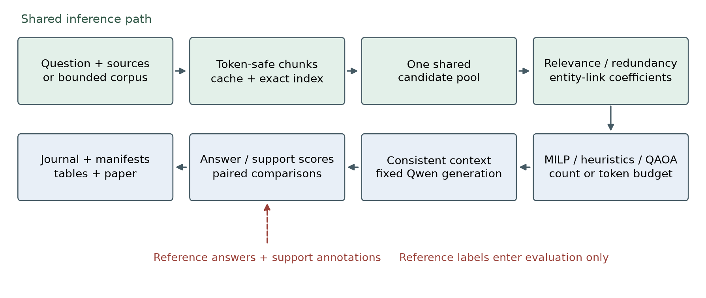
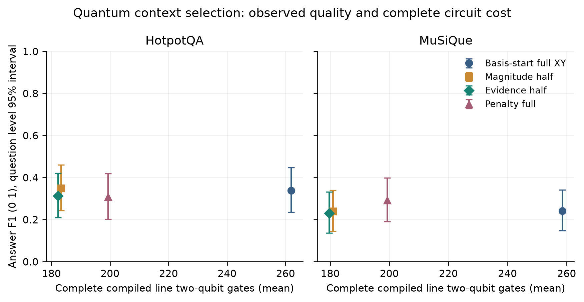

# An Encoding-Aware Evaluation of Sparse QAOA Context Selection for Multi-Hop RAG

Research manuscript draft. All quantum execution in this study is classical simulation.

## Abstract

<!-- BEGIN ABSTRACT -->
We evaluate context selection for multi-hop retrieval augmented generation using the quantum approximate optimization algorithm (QAOA), classical references and complete circuit compilation. The frozen primary matrix contains 50,290 method/question evaluations over 1,000 distinct held-out questions, including two Qwen generators and 50-question quantum conditions per dataset with three seeds. We separate scoring quality, sparse-objective quality and solver behavior. Squared count penalties introduce all-pairs couplings; count-preserving mixing avoids this densification but adds its own cost. The principal evidence-minus-magnitude answer F1 differences are -0.0363 on HotpotQA and -0.0095 on MuSiQue, with both paired 95% intervals crossing zero. We identify an inactive first cost phase in the basis-start depth-one circuit and retain its results alongside an exploratory feasible-superposition control; neither supports a consistent evidence-guidance benefit. Uniform feasible sampling is a strong reference when only 252 subsets exist. Lexical coverage has the highest observed F1 in all four main classical count conditions. We release question outcomes, frozen optimization instances, source snapshots and resource metadata. All quantum execution is simulated; practical quantum advantage is not established.
<!-- END ABSTRACT -->

Keywords: retrieval augmented generation; quantum approximate optimization; context selection; sparsification; reproducible evaluation.

## 1. Introduction

Retrieval augmented generation supplies external passages to a language model. For a multi-hop question, a useful context may require several passages that jointly provide a reasoning chain. Ranking each passage independently can omit a bridge. Selecting a subset jointly is therefore a reasonable optimization problem, but a mathematically low energy need not imply a correct answer. The objective remains a proxy for useful evidence.

Quantum approximate optimization offers a way to sample low-energy binary decisions using a parameterized circuit. Its practical cost depends on the complete encoding, not only the number of terms in a semantic scoring model. In particular, a squared cardinality penalty creates couplings between every pair of candidates. Removing semantic interactions may therefore fail to reduce the circuit's interaction count. A count-preserving mixer avoids that penalty but introduces preparation and mixer costs of its own.

We investigate these effects in a controlled context-selection pipeline. Our questions are separate: whether a graph-derived pair feature transfers to answer quality; whether protecting possible evidence links helps sparsification at the same retained-edge budget; and how constraint encoding changes feasibility and compiled cost. We compare classical optimization, heuristics, uniform feasible sampling and actual QAOA simulations. We do not assume a quantum advantage or describe fewer symbolic edges as a demonstrated hardware improvement.

The contribution is a reproducible, encoding-aware empirical evaluation with question-level answer outcomes, full-objective bookkeeping and complete circuit compilation. The graph signal is deliberately transparent and limited: it uses entity links with exact source spans, not verified semantic relations. The evaluation includes unfavorable outcomes and a documented implementation restart. Publication novelty and significance remain subject to external review.

## 2. Related work and comparison boundary

RAG combines retrieval with generation [1], and dense passage retrieval establishes a widely used vector-search approach [2]. SetR treats retrieval output as a set chosen to satisfy information requirements [3]. Requirement-aware QUBO evidence selection already combines relevance, coverage and complementarity and reports downstream QA experiments using unconventional-solver-compatible formulations [4]. We therefore do not claim that QUBO evidence selection itself is new. Our lexical coverage comparator is not an exact reproduction of either method's semantic estimators or original model configuration.

Graph retrieval systems such as GRiever and HippoRAG show that graph structures can support multi-hop retrieval [5,6]. Their retrieval architectures differ from an interchangeable selector over one frozen candidate pool. We keep supplied-pool selection separate from bounded corpus retrieval. Context position can also affect generation [7], so competing selectors use a common ordering policy.

QAOA and the alternating operator ansatz provide the algorithmic foundations [8,9]. Prior sparsification work studies QAOA compilation and noise for Max-Cut [10]. Our signed relevance/complementarity objective and context-budget constraints require separate evaluation; the elementary coefficient-removal bound used below is a sanity check, not a new theorem. A complete 19-source comparison matrix accompanies the software.

## 3. Problem and representations

For question q and candidates p_1 through p_n, let x_i be 1 when passage i is supplied to the generator. Inference inputs contain question text, source text and provenance. Reference answers and supporting annotations are loaded into separate evaluation objects. Graph construction, candidate reduction and normal selection cannot access these annotations.

The frozen MiniLM encoder has a limited input length. We form sentence-aware chunks of at most 240 embedding tokens including a bounded title prefix. Oversized sentences use overlapping offset windows. Every chunk retains its original character range and sentence mapping. A passage vector is the normalized arithmetic mean of its normalized chunk vectors. This uses later passage content that the original prototype truncated, but mean pooling is itself an approximation and can dilute small relevant facts.

Relevance r_i is the inner product of unit question and passage vectors. Redundancy uses the positive part of passage cosine similarity. Candidate-title matches and capitalized spans induce an entity-link graph. Let L_ij indicate a shared extracted entity and let a_i denote the fraction of question content terms found in passage i. The complementarity proxy is:

$$
C_{ij}=L_{ij}\max(a_i,a_j)\sqrt{\max(r_i,0)\max(r_j,0)}.
$$

This feature is nonnegative but is not a probability of support. Shared names can produce false links. Source surface forms are stored separately from canonical names to preserve exact Unicode offsets. A content-addressed SQLite cache identifies embedding and graph artifacts by text, immutable model revision and preprocessing/extractor settings.

## 4. Selection objectives and constraints

The common full target is:

$$
E_{\mathrm{full}}(x)=\sum_i a_i^{\mathrm{obj}}x_i+\sum_{i<j}b_{ij}x_ix_j,
$$

$$
a_i^{\mathrm{obj}}=-\alpha r_i,\qquad b_{ij}=\beta\max(s_{ij},0)-\gamma C_{ij}.
$$

We distinguish the objective coefficient from the question-anchor notation. Alpha is 1 and beta is 0.2. Gamma is selected on development data from {0,0.1,0.2,0.4,0.8}; 0.2 gives the highest equal-weight mean development answer F1 across the two datasets. Gamma=0 is the base-formulation control. These choices are frozen before definitive held-out execution.

Fixed-count experiments impose sum(x_i)=k, with k=5 when enough candidates exist. A declared use-all policy applies when fewer are available. Separate token-budget experiments impose a linear conservative cost cap and a nonempty selection. Actual formatted context and total prompt tokens are independently checked; overlong contexts become failures rather than being silently trimmed. Equal count does not imply equal tokens, and equal caps do not imply equal consumption.

$$
\sum_i x_i=k \quad\mathrm{or}\quad \sum_i t_i x_i\leq B,\qquad \sum_i x_i\geq1.
$$

MILP introduces continuous y_ij in [0,1] with y_ij <= x_i, y_ij <= x_j and y_ij >= x_i+x_j-1. Binary x makes y equal the product regardless of the pair coefficient sign. Native count/token constraints avoid penalty encoding in the classical solver. We record incumbents, bounds, status and time limits; only a certified optimum is called optimal. Exhaustive enumeration validates tiny signed instances.

$$
0\leq y_{ij}\leq1,\quad y_{ij}\leq x_i,\quad y_{ij}\leq x_j,\quad y_{ij}\geq x_i+x_j-1.
$$

## 5. Sparse surrogates

A sparse target keeps an exact budget floor(f*m) of the m nonzero unordered pair coefficients. Linear terms are unchanged. Controls retain the largest absolute coefficients, a seeded random set, or edges prioritized by the smaller of their endpoint incident ranks. All retained signs and magnitudes are preserved.

Evidence guidance ranks linked edges by C_ij times the square root of absolute coefficient magnitude. It reserves up to half the hard budget, rounded upward, for possible bridges, then fills remaining slots by magnitude. If too many links qualify, only the highest-priority links fit; if none qualify, the rule becomes magnitude retention. This protection policy is a hypothesis about useful structure, not guaranteed evidence preservation.

For removed interactions R, define delta as their total absolute coefficient mass. Each binary product is at most 1, giving the bound:

$$
|E_{\mathrm{full}}(x)-E_{\mathrm{sparse}}(x)|\leq\delta.
$$

For the same feasible set, an epsilon-suboptimal sparse solution has full-objective gap at most 2*delta+epsilon. This follows by applying the bound to the returned solution and the full optimum. It says nothing about answer F1. Every returned subset is evaluated under both energies so sparse energies are never compared as if they were the same objective scale.

## 6. Quantum implementation and resource accounting

Substituting x_i=(1-Z_i)/2 yields an Ising Hamiltonian with a constant offset, single-qubit fields and pair couplings:

$$
H_C=cI+\sum_i h_i Z_i+\sum_{i<j}J_{ij}Z_iZ_j,\qquad J_{ij}=b_{ij}/4.
$$

$$
h_i=-a_i^{\mathrm{obj}}/2-\left(\sum_{j<i}b_{ji}+\sum_{j>i}b_{ij}\right)/4.
$$

$$
c=\sum_i a_i^{\mathrm{obj}}/2+\sum_{i<j}b_{ij}/4.
$$

For a penalty encoding, the same mapping is applied after expanding the penalty, with its constant offset retained in energy accounting. A positive phase scale, the larger of one and the largest absolute field/coupling, normalizes circuit phase angles; expectations are evaluated against the original encoded energy. Tests verify all basis-state energies and little-endian candidate mapping on small instances. QAOA uses depths p in {1,2}, COBYLA with a maximum of 64 function evaluations, three recorded seeds and 1,024 final samples. The main study trains exact statevector expectations; a separate development control uses finite-shot training. A bounded diagnostic applies synthetic noise only during final sampling.

The penalty encoding adds lambda*(sum(x_i)-k)^2. Choosing lambda as one plus the sum of absolute original coefficients is sufficient to make every infeasible global minimum worse than a feasible solution. This does not guarantee feasible measurements after finite shallow optimization. Expansion adds 2*lambda to every unordered pair, making the encoded cost graph dense even when the semantic graph is sparse.

$$
E_{\lambda}(x)=E(x)+\lambda\left(\sum_i x_i-k\right)^2,\qquad\lambda=1+\sum_i|a_i^{\mathrm{obj}}|+\sum_{i<j}|b_{ij}|.
$$

The alternative starts from a seeded feasible basis state and applies a ring of RXX(beta) followed by RYY(beta) on each edge. Their paired product implements XY exchange and preserves the number of ones ideally. It is not uniform feasible-state preparation, and its shallow expressivity depends on the initial basis state. Preparation and mixer operations are included in resource counts.

There is a specific limitation of this frozen basis-start circuit. A diagonal cost unitary acting first on one computational basis state produces only a global phase. Thus the first cost angle is inactive in probabilities, and p=1 has only mixer-dependent probabilities. Its optimized mixer angle can still depend on which objective is minimized. We retain this diagnostic implementation and add an explicitly exploratory control: one fixed pi/4 XY ring sweep prepares a generally nonuniform feasible superposition before cost evolution. Its full preparation cost is compiled. This control is not presented as uniform Dicke-state preparation, a globally optimized ansatz, or a predeclared replacement for the primary comparison.

For first cost angle theta and any subsequent mixer, linearity gives:

$$
U_M e^{-i\theta H_C}|x_0\rangle=e^{-i\theta E(x_0)}U_M|x_0\rangle.
$$

The common phase has unit magnitude and cancels from measurement probabilities. Preparation creates several nonzero basis amplitudes, allowing later cost-dependent relative phases to affect interference. This algebra explains the degeneracy independently of answer outcomes.

We compile complete circuits to rz/sx/x/cx with fixed settings and seeds on synthetic all-to-all and line connectivity. We report qubits, two-qubit gates, depth and feasible-shot fractions. These targets are not calibrated devices. Simulation time is a classical implementation measurement and is never presented as a quantum hardware speedup.

The final selected context is the minimum-surrogate-energy feasible measured sample, with deterministic tie-breaking and no repair. This best-of-many policy includes classical energy evaluation. A uniform feasible-sampling control uses the same number of draws. For n=10,k=5 there are only 252 feasible subsets, and 1,024 uniform feasible draws have about 98.3% probability of including one particular optimum. Larger candidate sensitivities therefore remain important even when small-case solutions look strong.

## 7. Experimental setup

We use HotpotQA and MuSiQue-Ans with dataset-specific adapters and official answer-score semantics [11,12]. Each dataset has 100 development questions and 500 fresh held-out questions from the official validation/dev partition. Earlier inspected local HotpotQA IDs are excluded. Frozen ID lists, source revisions and hashes are released; these are not hidden-test results. Exact normalized questions and token-trigram near matches were audited, but paraphrases and pretrained-model exposure remain unknown.

The main classical study evaluates two frozen Qwen generators, 1.5B and 3B, with identical settings across selectors. It includes relevance, BM25, hybrid ranking, a fixed chunk-aware cross-encoder, MMR, lexical coverage, greedy energy, annealing, random feasible sampling, full MILP and sparse MILPs. These generators share a model family, limiting architectural generalization.

The generators are Qwen2.5-1.5B-Instruct and Qwen2.5-3B-Instruct, using greedy decoding, float16 weights, at most 32 new tokens and a 4,096-token total bound. Execution uses a Ryzen AI 7 350 laptop with 16 logical CPUs, about 22 GiB host RAM and an RTX 5060 Laptop GPU with approximately 7.53 GiB of PyTorch-visible memory; numerical threads are limited to four. Immutable model revisions and full software versions are released in configurations and manifests.

The main quantum study uses the first 50 frozen IDs per dataset and a shared relevance-reduced pool of at most ten candidates. Reduction is label-independent and applies to the classical references too. Three seeds are averaged within question before paired bootstrap resampling. Five-question 12/16-candidate MuSiQue sensitivities use real supplied candidates. Token studies and bounded corpus studies have their own declared sample sizes and are not pooled with the primary count experiment.

The bounded corpora contain the deduplicated union of benchmark input passages. Exact chunk search and BM25 rank fusion construct common pools of 25/50/100 passages. This is a closed-corpus diagnostic, not full-Wikipedia retrieval. Larger MILPs use a one-second limit with status and bounds retained.

Primary task quality is mean per-question answer F1; normalized exact match and supporting-document metrics are secondary. Failures remain zero in answer denominators. Successful-only resource/evidence summaries are labeled. Confidence intervals use 10,000 paired question bootstrap resamples with seed 20261110. Seeds are repeated solver attempts, not independent questions. No noninferiority margin or family of confirmatory p-values is claimed.

An initial execution cycle was stopped after a Unicode provenance assertion failed. All definitive conditions were restarted with the same scientific settings after a targeted repair; superseded artifacts and an erratum are retained. This separates debugging from answer-based retuning.

## 8. Results

<!-- BEGIN RESULTS -->
### Classical supplied-pool answers

| Dataset / generator | Method | N | Answer F1 | EM |
| --- | --- | ---: | ---: | ---: |
| hotpotqa / qwen15 | top_k | 500 | 0.4402 | 0.3460 |
| hotpotqa / qwen15 | bm25 | 500 | 0.4737 | 0.3680 |
| hotpotqa / qwen15 | reranker | 500 | 0.4538 | 0.3560 |
| hotpotqa / qwen15 | coverage | 500 | 0.4944 | 0.3860 |
| hotpotqa / qwen15 | milp_base | 500 | 0.4546 | 0.3520 |
| hotpotqa / qwen15 | milp_full | 500 | 0.4517 | 0.3500 |
| hotpotqa / qwen3 | top_k | 500 | 0.4200 | 0.3340 |
| hotpotqa / qwen3 | bm25 | 500 | 0.4545 | 0.3740 |
| hotpotqa / qwen3 | reranker | 500 | 0.4266 | 0.3320 |
| hotpotqa / qwen3 | coverage | 500 | 0.4801 | 0.3820 |
| hotpotqa / qwen3 | milp_base | 500 | 0.4220 | 0.3400 |
| hotpotqa / qwen3 | milp_full | 500 | 0.4357 | 0.3540 |
| musique / qwen15 | top_k | 500 | 0.2434 | 0.1660 |
| musique / qwen15 | bm25 | 500 | 0.2247 | 0.1580 |
| musique / qwen15 | reranker | 500 | 0.2378 | 0.1760 |
| musique / qwen15 | coverage | 500 | 0.2714 | 0.1920 |
| musique / qwen15 | milp_base | 500 | 0.2448 | 0.1720 |
| musique / qwen15 | milp_full | 500 | 0.2491 | 0.1740 |
| musique / qwen3 | top_k | 500 | 0.1594 | 0.1160 |
| musique / qwen3 | bm25 | 500 | 0.1418 | 0.1060 |
| musique / qwen3 | reranker | 500 | 0.1677 | 0.1220 |
| musique / qwen3 | coverage | 500 | 0.1896 | 0.1400 |
| musique / qwen3 | milp_base | 500 | 0.1652 | 0.1140 |
| musique / qwen3 | milp_full | 500 | 0.1599 | 0.1100 |

F1/EM use a 0-1 scale. Each main condition has 500 questions. The complete method tables, token lengths, failures and paired intervals are released with the artifacts; selected headline rows above do not replace them.

### Quantum quality, feasibility and complete cost

| Dataset | Method | Answer F1 | Feasible shots | Line 2Q gates |
| --- | --- | ---: | ---: | ---: |
| hotpotqa | milp_full | 0.3311 | - | - |
| hotpotqa | random_full | 0.3378 | - | - |
| hotpotqa | xy_full_p1 | 0.3379 | 1.0000 | 261.9 |
| hotpotqa | xy_full_p2 | 0.3051 | 1.0000 | 545.0 |
| hotpotqa | xy_absolute_f0.5 | 0.3490 | 1.0000 | 183.2 |
| hotpotqa | xy_evidence_f0.5 | 0.3128 | 1.0000 | 182.2 |
| hotpotqa | penalty_full | 0.3079 | 0.3574 | 199.3 |
| hotpotqa | penalty_absolute | 0.3200 | 0.3515 | 199.3 |
| hotpotqa | penalty_evidence | 0.3013 | 0.3562 | 199.3 |
| musique | milp_full | 0.3178 | - | - |
| musique | random_full | 0.3178 | - | - |
| musique | xy_full_p1 | 0.2418 | 1.0000 | 258.6 |
| musique | xy_full_p2 | 0.2436 | 1.0000 | 544.2 |
| musique | xy_absolute_f0.5 | 0.2399 | 1.0000 | 180.9 |
| musique | xy_evidence_f0.5 | 0.2304 | 1.0000 | 179.7 |
| musique | penalty_full | 0.2919 | 0.3753 | 199.3 |
| musique | penalty_absolute | 0.2667 | 0.3687 | 199.3 |
| musique | penalty_evidence | 0.2644 | 0.3617 | 199.3 |

The quantum conditions use the same 50 reduced-pool questions per dataset. Three seeds are averaged within question for F1. Feasibility and gate means include all completed circuits, including zero-feasible-sample failures. Classical rows have no quantum gate count rather than an invented zero. Gates describe a complete compiled circuit on the synthetic line.

### Principal half-edge comparison

| Dataset | Evidence minus magnitude F1 | 95% paired interval |
| --- | ---: | --- |
| hotpotqa | -0.0363 | [-0.0843, 0.0035] |
| musique | -0.0095 | [-0.0461, 0.0199] |

These intervals compare evidence guidance with magnitude retention on identical questions and budgets. An interval spanning zero does not establish equality or noninferiority.

### Secondary complete-gate-cap control

| Dataset | Rule | N | F1 | Mean line 2Q | Failed records |
| --- | --- | ---: | ---: | ---: | ---: |
| hotpotqa | gate_absolute | 10 | 0.2500 | 170.1 | 0 |
| hotpotqa | gate_evidence | 10 | 0.2500 | 170.1 | 0 |
| hotpotqa | gate_penalty_control | 10 | 0.0000 | - | 10 |
| musique | gate_absolute | 10 | 0.2033 | 171.9 | 0 |
| musique | gate_evidence | 10 | 0.2167 | 171.9 | 0 |
| musique | gate_penalty_control | 10 | 0.0000 | - | 10 |

The cap is 180 complete compiled line two-qubit gates. Retention is chosen using declared inference-only prefix trials and verified after angle optimization. Infeasible penalty encodings and final-cap violations remain failures. Actual resource consumption can differ below a shared cap.

### Additional settings and failures

The definitive primary matrix contains 50,290 method/question evaluations. Outside the deliberately restrictive gate-cap diagnostic, the grouped tables contain 1 failed method records. Token studies, bounded corpora, larger-quantum sensitivities and the base/graph QAOA control are separately tabulated in the released result directory. Their smaller samples are not pooled into the principal comparison.

All aggregate values derive from question-level artifacts. Successful-only resource summaries exclude failed executions and are labeled accordingly. Timings are descriptive laptop measurements; software packaging tasks ran concurrently with parts of evaluation, so they are not isolated production-throughput benchmarks.

### Exploratory feasible-superposition control

The frozen XY implementation starts from a basis state. Its first diagonal cost layer contributes only a global phase; at p=1 its cost angle cannot affect probabilities. We retained those results and separately added one fixed pi/4 XY ring sweep before the first cost layer. This creates a feasible, generally nonuniform superposition and makes subsequent cost phases observable after mixing. The added sweep is included in complete compilation. This control was introduced after the analytic diagnosis and is exploratory, not a replacement for the principal frozen comparison.

| Dataset | Prepared method | F1 | Mean complete line 2Q |
| --- | --- | ---: | ---: |
| hotpotqa | prepared_base_p1 | 0.3291 | 352.9 |
| hotpotqa | prepared_full_p1 | 0.2922 | 354.3 |
| hotpotqa | prepared_full_p2 | 0.3134 | 642.3 |
| hotpotqa | prepared_absolute_f0.5 | 0.2903 | 275.4 |
| hotpotqa | prepared_evidence_f0.5 | 0.3055 | 273.0 |
| musique | prepared_base_p1 | 0.2725 | 349.3 |
| musique | prepared_full_p1 | 0.2606 | 349.8 |
| musique | prepared_full_p2 | 0.2885 | 638.5 |
| musique | prepared_absolute_f0.5 | 0.2533 | 276.0 |
| musique | prepared_evidence_f0.5 | 0.2636 | 273.5 |

### Formulation effects and token-budget sensitivity

| Dataset / generator | Budget | N | Graph minus base F1 | 95% paired interval |
| --- | --- | ---: | ---: | --- |
| hotpotqa / qwen15 | count | 500 | -0.0029 | [-0.0288, 0.0237] |
| hotpotqa / qwen15 | tokens | 100 | 0.0663 | [-0.0028, 0.1378] |
| hotpotqa / qwen3 | count | 500 | 0.0138 | [-0.0147, 0.0424] |
| hotpotqa / qwen3 | tokens | 100 | 0.0471 | [-0.0089, 0.1038] |
| musique / qwen15 | count | 500 | 0.0043 | [-0.0171, 0.0253] |
| musique / qwen15 | tokens | 100 | 0.0302 | [-0.0093, 0.0730] |
| musique / qwen3 | count | 500 | -0.0053 | [-0.0254, 0.0141] |
| musique / qwen3 | tokens | 100 | -0.0487 | [-0.1105, 0.0088] |

The graph feature's effect varies across settings; these exploratory intervals all include zero. Count conditions use 500 questions, whereas the 1,200-token-cap conditions use the first 100 frozen IDs. Their raw means cannot establish a count-versus-token causal effect across different question populations. The cap is checked against actual formatted context; observed consumption varies below it.

### Bounded corpus retrieval

| Dataset | Candidates | N | Candidate support recall | Coverage F1 | Full MILP F1 | MILP certified fraction |
| --- | ---: | ---: | ---: | ---: | ---: | ---: |
| hotpotqa | 25 | 100 | 0.9200 | 0.4420 | 0.4095 | 1.0000 |
| hotpotqa | 50 | 30 | 0.9333 | 0.2754 | 0.2806 | 0.5333 |
| hotpotqa | 100 | 30 | 0.9667 | 0.2848 | 0.2694 | 0.4000 |
| musique | 25 | 100 | 0.6558 | 0.2264 | 0.1751 | 1.0000 |
| musique | 50 | 30 | 0.7111 | 0.1611 | 0.1167 | 0.0667 |
| musique | 100 | 30 | 0.7444 | 0.1690 | 0.1000 | 0.0333 |

The 25-candidate condition uses 100 questions; 50/100-candidate conditions use the same first 30 IDs. Candidate recall is measured before selection, using annotations only during evaluation. Increasing a pool can recover annotated support while also increasing optimization difficulty and adding distractors. The one-second MILP setting can return feasible incumbents without an optimality certificate. Larger-pool results do not demonstrate quantum scaling.

### Objective quality is not answer quality

Across the four 500-question fixed-count conditions, full MILP has lower common-objective energy but worse F1 than relevance selection on respectively 31, 37, 36, 32 questions (HotpotQA 1.5B/3B, MuSiQue 1.5B/3B). The relevance subset is rescored using the full MILP coefficients for this comparison. These observations directly distinguish proxy optimization from downstream correctness; they do not independently identify a causal graph or generator error. Deterministic examples and additional signatures are released.

<!-- END RESULTS -->

<!-- BEGIN SAMPLING -->
### Development-derived sampling mechanism study

To separate trained distribution quality from best-of-many selection, we train p=1 circuits on 20 development-derived coefficient instances at each of n=8,10,12,16, with k=5 and three seeds per encoding. These are 480 numerical circuit solves, not additional held-out answer evaluations. For single-draw optimum mass u, the probability of seeing an optimum in S draws is 1-(1-u)^S. We compute this directly from the trained ideal statevector distribution and enumerate feasible energies. This calculation does not estimate a physical device's output distribution.

| Candidates | Encoding | Uniform P(optimum), 1,024 draws | QAOA P(optimum), 1,024 draws | Conditional QAOA energy gap |
| --- | --- | ---: | ---: | ---: |
| 8 | xy | 1.0000 | 0.1178 | 0.1343 |
| 8 | penalty | 1.0000 | 0.9689 | 0.0008 |
| 10 | xy | 0.9829 | 0.0624 | 0.1647 |
| 10 | penalty | 0.9829 | 0.7415 | 0.0061 |
| 12 | xy | 0.7258 | 0.0049 | 0.2457 |
| 12 | penalty | 0.7258 | 0.1949 | 0.0472 |
| 16 | xy | 0.2090 | 0.0000 | 0.3141 |
| 16 | penalty | 0.2090 | 0.0127 | 0.1463 |

Means average seeds within question first. Conditional gaps describe the best feasible sample given that at least one is drawn; no-feasible probabilities and paired question intervals are also released. This development diagnostic compares final draws only: QAOA additionally performs angle training with up to 64 exact-expectation evaluations, whereas uniform feasible sampling does not. The same 20 questions recur across sizes, so the four size groups are not independent replications.

<!-- END SAMPLING -->

## 9. Limitations and threats to validity

The entity-link proxy lacks independent semantic annotation and can reward spurious links. Its query-term anchors are lexical, not a verified decomposition of information requirements. No original-model reproduction of SetR or the closest QUBO selector is claimed. Small open generators and one embedding model limit generalization. Reference normalization can penalize semantically related answers, and reference annotations themselves can contain errors.

The quantum subset is much smaller than the classical evaluation and includes ideal training, finite-shot postselection and only bounded artificial-noise diagnostics. The count-preserving state starts in one feasible basis state. Gate counts depend on compiler target and settings; physical calibration, connectivity, readout errors, queueing and fault-tolerant overhead are absent. Larger n sensitivities are too small for broad answer-quality claims.

The full objective is a proxy. Better energy, more annotated support and better answer F1 are different observations. A sparse surrogate may change selected contexts even when its objective gap is small. The elementary coefficient bound does not establish semantic preservation. A nonsignificant paired difference does not establish equality. Resource measurements on a laptop are descriptive and do not establish industrial throughput or hardware advantage.

The original basis-start p=1 circuit is structurally weak because its first cost phase is global. Complete gate counts use a fixed generic compilation policy, not a proof of minimum circuit cost; a semantics-aware compiler could remove known-basis diagonal work. The added preparation control addresses this particular degeneracy but is exploratory. Beta is held at 0.2 while gamma receives a limited development sweep; neither the objective nor the variational circuit is claimed to be the strongest possible classical or quantum method. Question-level bootstrap intervals also do not model every dependency caused by shared source passages or question composition.

Corpora are bounded unions of benchmark inputs with known source inclusion, not a deployment-scale open collection. Question deduplication cannot eliminate source overlap or pretrained-model contamination. The service is a local demonstration with bounded jobs and labeled fallbacks; its reliability behavior is excluded from QAOA-only research results.

## 10. Reproducibility and release

The software exposes configuration-driven study and report commands, immutable model revisions, source snapshots, checksums, per-question predictions, actual prompts/token IDs, solver traces and complete-circuit resources. A durable append journal supports interrupted-write recovery and explicit failure retries without replacing successful outcomes. Compact public evidence links to hashes of full local artifacts. Raw datasets and weights are obtained from their primary hosts under their own licenses.

Tests cover official-scorer agreement, label isolation, offsets, cache/index invalidation, signed MILP correctness, quantum spectra, count preservation, feasible sampling, sparsification budgets, statistics and service failure paths. A separate FastAPI package uses the same research library, avoiding a second implementation of scientific scoring. The artifact package documents tested environments and remaining external review requirements.

AI assistance was used to develop software, orchestrate local experiments, inspect artifacts and draft technical documentation and this manuscript. This involved substantive generation beyond copy editing. Numerical statements are computed from saved artifacts rather than supplied by the assistant from memory. Human authors must independently review and take responsibility for the full methods, code, results, citations and final text before submission; that external review is not represented as completed here.

## 11. Conclusion

<!-- BEGIN CONCLUSION -->
Constraint encoding is part of the sparsification method, not an accounting detail. A sparse semantic objective can become dense again after a cardinality penalty, while a feasible-subspace mixer has an explicit resource cost. Evidence guidance does not show a consistently positive paired interval across both datasets under this setup. Strong classical and same-sample random controls remain essential when the feasible space is small. State preparation also determines whether a cost layer can affect probabilities, and the exploratory prepared results do not establish a consistent evidence-guidance gain. The released pipeline supports transparent future hardware and stronger-evidence studies, but the present results do not establish practical quantum advantage or guaranteed evidence preservation.
<!-- END CONCLUSION -->

## References

[1] Lewis et al. Retrieval-Augmented Generation for Knowledge-Intensive NLP Tasks. 2020. https://arxiv.org/abs/2005.11401

[2] Karpukhin et al. Dense Passage Retrieval for Open-Domain Question Answering. 2020. https://arxiv.org/abs/2004.04906

[3] Lee et al. Shifting from Ranking to Set Selection for Retrieval Augmented Generation. ACL 2025. https://aclanthology.org/2025.acl-long.861/

[4] Singh and Vadlamani. QUBO-Optimized Evidence Selection for Retrieval-Augmented Question Answering with Unconventional Solvers. 2026. https://arxiv.org/abs/2607.12334

[5] Melo et al. Don't Forget the Base Retriever! A Low-Resource Graph-based Retriever for Multi-hop Question Answering. EMNLP Industry 2025. https://aclanthology.org/2025.emnlp-industry.174/

[6] Jiménez Gutiérrez et al. HippoRAG: Neurobiologically Inspired Long-Term Memory for Large Language Models. 2024. https://arxiv.org/abs/2405.14831

[7] Liu et al. Lost in the Middle: How Language Models Use Long Contexts. 2023. https://arxiv.org/abs/2307.03172

[8] Farhi, Goldstone and Gutmann. A Quantum Approximate Optimization Algorithm. 2014. https://arxiv.org/abs/1411.4028

[9] Hadfield et al. From the Quantum Approximate Optimization Algorithm to a Quantum Alternating Operator Ansatz. 2019. https://arxiv.org/abs/1709.03489

[10] Moondra et al. Promise of Graph Sparsification and Decomposition for Noise Reduction in QAOA: Analysis for Trapped-Ion Compilations. Quantum 2026. https://arxiv.org/abs/2406.14330

[11] Yang et al. HotpotQA: A Dataset for Diverse, Explainable Multi-hop Question Answering. EMNLP 2018. https://aclanthology.org/D18-1259/

[12] Trivedi et al. MuSiQue: Multihop Questions via Single-hop Question Composition. TACL 2022. https://aclanthology.org/2022.tacl-1.31/
