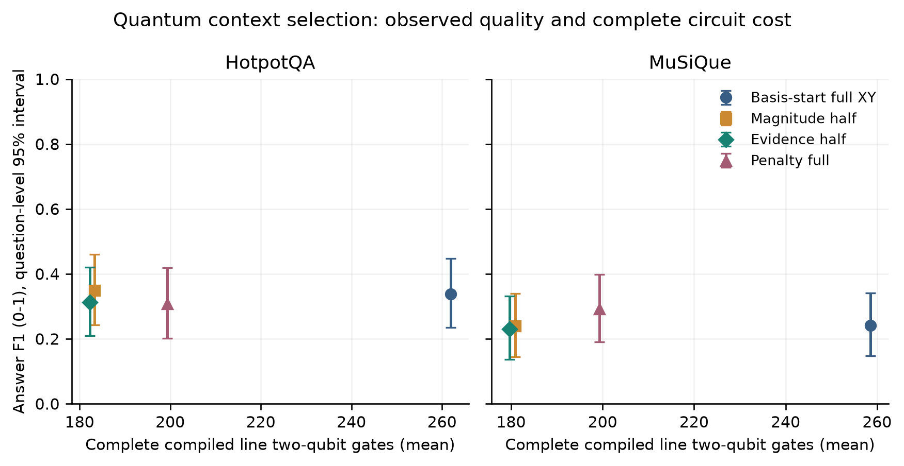

### Classical supplied-pool answers

| Dataset / generator | Method | N | Answer F1 | EM |
| --- | --- | ---: | ---: | ---: |
| hotpotqa / qwen15 | top_k | 500 | 0.4402 | 0.3460 |
| hotpotqa / qwen15 | bm25 | 500 | 0.4737 | 0.3680 |
| hotpotqa / qwen15 | reranker | 500 | 0.4538 | 0.3560 |
| hotpotqa / qwen15 | coverage | 500 | 0.4944 | 0.3860 |
| hotpotqa / qwen15 | milp_base | 500 | 0.4546 | 0.3520 |
| hotpotqa / qwen15 | milp_full | 500 | 0.4517 | 0.3500 |
| hotpotqa / qwen3 | top_k | 500 | 0.4200 | 0.3340 |
| hotpotqa / qwen3 | bm25 | 500 | 0.4545 | 0.3740 |
| hotpotqa / qwen3 | reranker | 500 | 0.4266 | 0.3320 |
| hotpotqa / qwen3 | coverage | 500 | 0.4801 | 0.3820 |
| hotpotqa / qwen3 | milp_base | 500 | 0.4220 | 0.3400 |
| hotpotqa / qwen3 | milp_full | 500 | 0.4357 | 0.3540 |
| musique / qwen15 | top_k | 500 | 0.2434 | 0.1660 |
| musique / qwen15 | bm25 | 500 | 0.2247 | 0.1580 |
| musique / qwen15 | reranker | 500 | 0.2378 | 0.1760 |
| musique / qwen15 | coverage | 500 | 0.2714 | 0.1920 |
| musique / qwen15 | milp_base | 500 | 0.2448 | 0.1720 |
| musique / qwen15 | milp_full | 500 | 0.2491 | 0.1740 |
| musique / qwen3 | top_k | 500 | 0.1594 | 0.1160 |
| musique / qwen3 | bm25 | 500 | 0.1418 | 0.1060 |
| musique / qwen3 | reranker | 500 | 0.1677 | 0.1220 |
| musique / qwen3 | coverage | 500 | 0.1896 | 0.1400 |
| musique / qwen3 | milp_base | 500 | 0.1652 | 0.1140 |
| musique / qwen3 | milp_full | 500 | 0.1599 | 0.1100 |

F1/EM use a 0-1 scale. Each main condition has 500 questions. The complete method tables, token lengths, failures and paired intervals are released with the artifacts; selected headline rows above do not replace them.

### Quantum quality, feasibility and complete cost

| Dataset | Method | Answer F1 | Feasible shots | Line 2Q gates |
| --- | --- | ---: | ---: | ---: |
| hotpotqa | milp_full | 0.3311 | - | - |
| hotpotqa | random_full | 0.3378 | - | - |
| hotpotqa | xy_full_p1 | 0.3379 | 1.0000 | 261.9 |
| hotpotqa | xy_full_p2 | 0.3051 | 1.0000 | 545.0 |
| hotpotqa | xy_absolute_f0.5 | 0.3490 | 1.0000 | 183.2 |
| hotpotqa | xy_evidence_f0.5 | 0.3128 | 1.0000 | 182.2 |
| hotpotqa | penalty_full | 0.3079 | 0.3574 | 199.3 |
| hotpotqa | penalty_absolute | 0.3200 | 0.3515 | 199.3 |
| hotpotqa | penalty_evidence | 0.3013 | 0.3562 | 199.3 |
| musique | milp_full | 0.3178 | - | - |
| musique | random_full | 0.3178 | - | - |
| musique | xy_full_p1 | 0.2418 | 1.0000 | 258.6 |
| musique | xy_full_p2 | 0.2436 | 1.0000 | 544.2 |
| musique | xy_absolute_f0.5 | 0.2399 | 1.0000 | 180.9 |
| musique | xy_evidence_f0.5 | 0.2304 | 1.0000 | 179.7 |
| musique | penalty_full | 0.2919 | 0.3753 | 199.3 |
| musique | penalty_absolute | 0.2667 | 0.3687 | 199.3 |
| musique | penalty_evidence | 0.2644 | 0.3617 | 199.3 |

The quantum conditions use the same 50 reduced-pool questions per dataset. Three seeds are averaged within question for F1. Feasibility and gate means include all completed circuits, including zero-feasible-sample failures. Classical rows have no quantum gate count rather than an invented zero. Gates describe a complete compiled circuit on the synthetic line.

### Principal half-edge comparison

| Dataset | Evidence minus magnitude F1 | 95% paired interval |
| --- | ---: | --- |
| hotpotqa | -0.0363 | [-0.0843, 0.0035] |
| musique | -0.0095 | [-0.0461, 0.0199] |

These intervals compare evidence guidance with magnitude retention on identical questions and budgets. An interval spanning zero does not establish equality or noninferiority.

### Secondary complete-gate-cap control

| Dataset | Rule | N | F1 | Mean line 2Q | Failed records |
| --- | --- | ---: | ---: | ---: | ---: |
| hotpotqa | gate_absolute | 10 | 0.2500 | 170.1 | 0 |
| hotpotqa | gate_evidence | 10 | 0.2500 | 170.1 | 0 |
| hotpotqa | gate_penalty_control | 10 | 0.0000 | - | 10 |
| musique | gate_absolute | 10 | 0.2033 | 171.9 | 0 |
| musique | gate_evidence | 10 | 0.2167 | 171.9 | 0 |
| musique | gate_penalty_control | 10 | 0.0000 | - | 10 |

The cap is 180 complete compiled line two-qubit gates. Retention is chosen using declared inference-only prefix trials and verified after angle optimization. Infeasible penalty encodings and final-cap violations remain failures. Actual resource consumption can differ below a shared cap.

### Additional settings and failures

The definitive primary matrix contains 50,290 method/question evaluations. Outside the deliberately restrictive gate-cap diagnostic, the grouped tables contain 1 failed method records. Token studies, bounded corpora, larger-quantum sensitivities and the base/graph QAOA control are separately tabulated in the released result directory. Their smaller samples are not pooled into the principal comparison.

All aggregate values derive from question-level artifacts. Successful-only resource summaries exclude failed executions and are labeled accordingly. Timings are descriptive laptop measurements; software packaging tasks ran concurrently with parts of evaluation, so they are not isolated production-throughput benchmarks.

### Exploratory feasible-superposition control

The frozen XY implementation starts from a basis state. Its first diagonal cost layer contributes only a global phase; at p=1 its cost angle cannot affect probabilities. We retained those results and separately added one fixed pi/4 XY ring sweep before the first cost layer. This creates a feasible, generally nonuniform superposition and makes subsequent cost phases observable after mixing. The added sweep is included in complete compilation. This control was introduced after the analytic diagnosis and is exploratory, not a replacement for the principal frozen comparison.

| Dataset | Prepared method | F1 | Mean complete line 2Q |
| --- | --- | ---: | ---: |
| hotpotqa | prepared_base_p1 | 0.3291 | 352.9 |
| hotpotqa | prepared_full_p1 | 0.2922 | 354.3 |
| hotpotqa | prepared_full_p2 | 0.3134 | 642.3 |
| hotpotqa | prepared_absolute_f0.5 | 0.2903 | 275.4 |
| hotpotqa | prepared_evidence_f0.5 | 0.3055 | 273.0 |
| musique | prepared_base_p1 | 0.2725 | 349.3 |
| musique | prepared_full_p1 | 0.2606 | 349.8 |
| musique | prepared_full_p2 | 0.2885 | 638.5 |
| musique | prepared_absolute_f0.5 | 0.2533 | 276.0 |
| musique | prepared_evidence_f0.5 | 0.2636 | 273.5 |

### Formulation effects and token-budget sensitivity

| Dataset / generator | Budget | N | Graph minus base F1 | 95% paired interval |
| --- | --- | ---: | ---: | --- |
| hotpotqa / qwen15 | count | 500 | -0.0029 | [-0.0288, 0.0237] |
| hotpotqa / qwen15 | tokens | 100 | 0.0663 | [-0.0028, 0.1378] |
| hotpotqa / qwen3 | count | 500 | 0.0138 | [-0.0147, 0.0424] |
| hotpotqa / qwen3 | tokens | 100 | 0.0471 | [-0.0089, 0.1038] |
| musique / qwen15 | count | 500 | 0.0043 | [-0.0171, 0.0253] |
| musique / qwen15 | tokens | 100 | 0.0302 | [-0.0093, 0.0730] |
| musique / qwen3 | count | 500 | -0.0053 | [-0.0254, 0.0141] |
| musique / qwen3 | tokens | 100 | -0.0487 | [-0.1105, 0.0088] |

The graph feature's effect varies across settings; these exploratory intervals all include zero. Count conditions use 500 questions, whereas the 1,200-token-cap conditions use the first 100 frozen IDs. Their raw means cannot establish a count-versus-token causal effect across different question populations. The cap is checked against actual formatted context; observed consumption varies below it.

### Bounded corpus retrieval

| Dataset | Candidates | N | Candidate support recall | Coverage F1 | Full MILP F1 | MILP certified fraction |
| --- | ---: | ---: | ---: | ---: | ---: | ---: |
| hotpotqa | 25 | 100 | 0.9200 | 0.4420 | 0.4095 | 1.0000 |
| hotpotqa | 50 | 30 | 0.9333 | 0.2754 | 0.2806 | 0.5333 |
| hotpotqa | 100 | 30 | 0.9667 | 0.2848 | 0.2694 | 0.4000 |
| musique | 25 | 100 | 0.6558 | 0.2264 | 0.1751 | 1.0000 |
| musique | 50 | 30 | 0.7111 | 0.1611 | 0.1167 | 0.0667 |
| musique | 100 | 30 | 0.7444 | 0.1690 | 0.1000 | 0.0333 |

The 25-candidate condition uses 100 questions; 50/100-candidate conditions use the same first 30 IDs. Candidate recall is measured before selection, using annotations only during evaluation. Increasing a pool can recover annotated support while also increasing optimization difficulty and adding distractors. The one-second MILP setting can return feasible incumbents without an optimality certificate. Larger-pool results do not demonstrate quantum scaling.

### Objective quality is not answer quality

Across the four 500-question fixed-count conditions, full MILP has lower common-objective energy but worse F1 than relevance selection on respectively 31, 37, 36, 32 questions (HotpotQA 1.5B/3B, MuSiQue 1.5B/3B). The relevance subset is rescored using the full MILP coefficients for this comparison. These observations directly distinguish proxy optimization from downstream correctness; they do not independently identify a causal graph or generator error. Deterministic examples and additional signatures are released.
