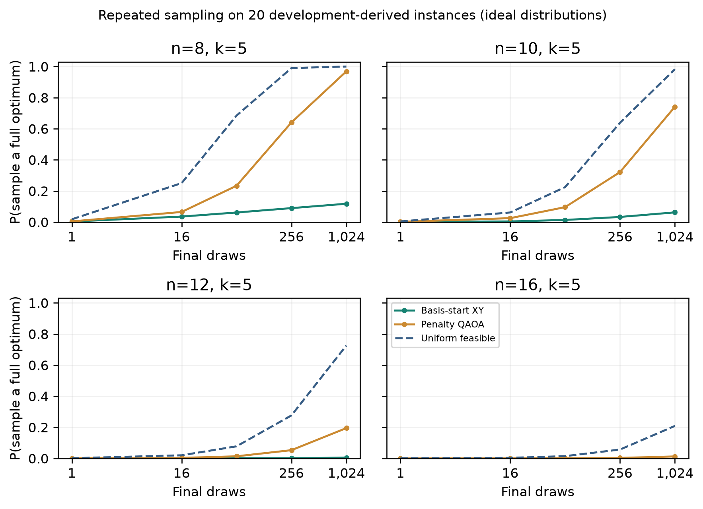

### Development-derived sampling mechanism study

To separate trained distribution quality from best-of-many selection, we train p=1 circuits on 20 development-derived coefficient instances at each of n=8,10,12,16, with k=5 and three seeds per encoding. These are 480 numerical circuit solves, not additional held-out answer evaluations. For single-draw optimum mass u, the probability of seeing an optimum in S draws is 1-(1-u)^S. We compute this directly from the trained ideal statevector distribution and enumerate feasible energies. This calculation does not estimate a physical device's output distribution.

| Candidates | Encoding | Uniform P(optimum), 1,024 draws | QAOA P(optimum), 1,024 draws | Conditional QAOA energy gap |
| --- | --- | ---: | ---: | ---: |
| 8 | xy | 1.0000 | 0.1178 | 0.1343 |
| 8 | penalty | 1.0000 | 0.9689 | 0.0008 |
| 10 | xy | 0.9829 | 0.0624 | 0.1647 |
| 10 | penalty | 0.9829 | 0.7415 | 0.0061 |
| 12 | xy | 0.7258 | 0.0049 | 0.2457 |
| 12 | penalty | 0.7258 | 0.1949 | 0.0472 |
| 16 | xy | 0.2090 | 0.0000 | 0.3141 |
| 16 | penalty | 0.2090 | 0.0127 | 0.1463 |

Means average seeds within question first. Conditional gaps describe the best feasible sample given that at least one is drawn; no-feasible probabilities and paired question intervals are also released. This development diagnostic compares final draws only: QAOA additionally performs angle training with up to 64 exact-expectation evaluations, whereas uniform feasible sampling does not. The same 20 questions recur across sizes, so the four size groups are not independent replications.

